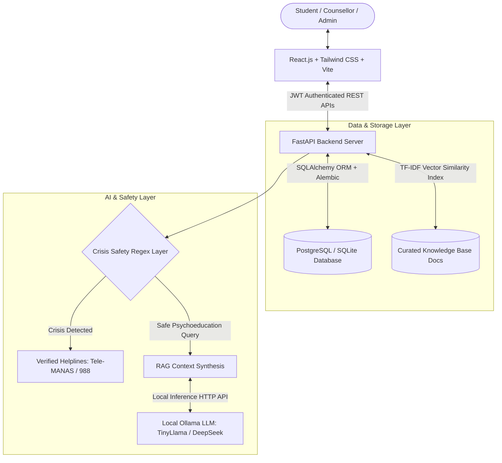

# MindBridge AI 🧠🌉
### Digital Mental Health and Psychological Support System for Students in Higher Education
> *"Your Mind Matters. Support Starts Here."*

**MindBridge AI** is an end-to-end, full-stack digital mental health platform engineered specifically for colleges and universities. It bridges the gap between student emotional distress and institutional healthcare through confidential, stigma-free self-screening, empathetic AI psychoeducation (RAG), daily mood journaling, and streamlined counsellor appointments.

Developed as a final-year **B.Tech Computer Science and Engineering (Data Science) Major Project**.

---

## 🌟 Key Features

1. **AI Mental Wellness Assistant ("MindBridge Assistant")**
   - Real-time conversational interface with persistent chat sessions.
   - Retrieval-Augmented Generation (RAG) powered by local Ollama LLMs and vector similarity search.
   - Grounded strictly in curated, verified student psychoeducation documents.
   - Displays reference source citations alongside responses.
   - **Crisis Safety Layer**: Intercepts distress or self-harm keywords immediately, bypassing the LLM to deliver compassionate intervention and verified 24/7 emergency hotlines (Tele-MANAS, 988 Lifeline).
   - Graceful fallback mode ensuring continuous operation even if the local LLM is offline.

2. **Standardized Clinical Screenings (PHQ-9 & GAD-7)**
   - **PHQ-9 (Patient Health Questionnaire)**: 9 standard questions (0–27 scale) measuring depression symptom severity.
   - **GAD-7 (Generalized Anxiety Disorder)**: 7 standard questions (0–21 scale) measuring generalized anxiety severity.
   - **Immediate Question 9 Safety Protocol**: Any non-zero answer to PHQ-9 Question 9 immediately triggers supportive emergency crisis contact resources.
   - Historical score progression graphs and longitudinal records.
   - Clear non-diagnostic disclaimers and next-step recommendations.

3. **Daily Mood Tracker & Confidential Journal**
   - 7 distinct emotional states: *Very Happy, Happy, Neutral, Anxious, Stressed, Sad, Very Sad*.
   - 14-day interactive emotional trajectory line chart (Recharts).
   - Private reflection journal with full CRUD, search, and mood associations.
   - **Strict Privacy Guarantee**: Student journals and chats are completely isolated and can never be viewed by campus administrators or third parties.

4. **Campus Counsellor Consultation System**
   - Directory of campus psychological counsellors with bios and areas of expertise (CBT, exam panic, burnout).
   - View available 45-minute consultation slots.
   - **Double-Booking Prevention**: Database-level unique constraints and atomic slot locking guarantee zero double-bookings.
   - **Counsellor Portal**: Set availability slots, accept or update appointment status (*Pending, Confirmed, Completed, Cancelled*), and append private administrative session notes.

5. **Self-Help Psychoeducation Library**
   - 8 evidence-based categories: *Stress Management, Anxiety Coping, Sleep Hygiene, Academic Burnout, Mindfulness & Breathing, Healthy Study Habits, Social Connection, Seeking Professional Help*.
   - Real-time full-text search and category filtering with estimated reading times.

6. **Privacy-Preserving Institutional Admin Analytics**
   - Aggregated campus-wide metrics: total students, completed screening distribution, appointment status breakdown, and resource engagement.
   - Minimum group threshold ($k \ge 3$) anonymity protection.
   - Zero access to identifiable individual student health records, journals, or chat transcripts.

---

## 🏗️ System Architecture



---

## 💻 Technology Stack

- **Frontend**: React.js (Vite), Tailwind CSS, React Router v6, Recharts, Lucide React
- **Backend**: Python 3.10+, FastAPI, Uvicorn, Pydantic v2, SQLAlchemy ORM, Alembic
- **Database**: PostgreSQL (Production) / SQLite (Zero-config local fallback)
- **AI & RAG**: Ollama (local LLM), LangChain, Vector Similarity Search, Scikit-Learn
- **Security**: JWT (JSON Web Tokens), Bcrypt password hashing, Role-Based Access Control (RBAC)

---

## ⚡ Quick Start (Local Setup on Windows)

### 1. Prerequisites
- **Python 3.10+** installed and added to PATH (`python --version`)
- **Node.js v18+** installed (`node --version`)
- **Ollama** installed (Optional for local AI inference: [ollama.ai](https://ollama.ai))

### 2. Clone & Inspect Directory
```powershell
git clone <repo-url>
cd MindBridge_AI
```

### 3. Backend Setup
1. Create and activate a Python virtual environment:
   ```powershell
   python -m venv venv
   .\venv\Scripts\activate
   ```
2. Install Python dependencies:
   ```powershell
   pip install -r backend\requirements.txt
   ```
3. Initialize database seed data (admin, counsellors, slots, resources):
   ```powershell
   python backend\scripts\seed_data.py
   ```
4. Verify document ingestion in the RAG knowledge base:
   ```powershell
   python backend\scripts\ingest_docs.py
   ```
5. Start the FastAPI backend server:
   ```powershell
   uvicorn app.main:app --host 127.0.0.1 --port 8000 --reload --app-dir backend
   ```
   *The interactive Swagger API documentation will be available at: [http://localhost:8000/docs](http://localhost:8000/docs)*

### 4. Frontend Setup
In a new terminal window:
1. Navigate to the `frontend` directory:
   ```powershell
   cd frontend
   ```
2. Install dependencies:
   ```powershell
   npm install
   ```
3. Start the Vite React development server:
   ```powershell
   npm run dev
   ```
4. Open your browser and navigate to: **[http://localhost:5173](http://localhost:5173)**

---

## 🪟 Windows Batch Shortcuts

For quick execution without typing commands:
- **`start_backend.bat`**: Activates the venv and launches FastAPI on port 8000.
- **`start_frontend.bat`**: Launches Vite dev server on port 5173.
- **`run_tests.bat`**: Runs the complete automated test suite with pytest.

---

## 🔑 Demo Login Credentials

The seed script preconfigures realistic accounts for evaluation. The login page also features **1-click quick-fill buttons**:

| Role | Email | Password | Access Privileges |
| :--- | :--- | :--- | :--- |
| **Student** | `student@mindbridge.edu` | `Student@123456` | Dashboard, AI Chat, PHQ-9, GAD-7, Mood Tracker, Private Journal, Counsellor Booking |
| **Counsellor** | `counsellor@mindbridge.edu` | `Counsellor@123456` | Counsellor Portal, Appointment Management, Availability Slot Scheduler |
| **Administrator** | `admin@mindbridge.edu` | `Admin@123456` | Institutional Wellness Analytics, Anonymized Distribution Metrics |

---

## 🤖 Ollama Local LLM Configuration

MindBridge AI uses Ollama for private, local on-premise inference:
1. Start the Ollama background daemon:
   ```powershell
   ollama serve
   ```
2. Pull the recommended lightweight local model:
   ```powershell
   ollama run tinyllama
   ```
   *(Or alternatively: `ollama run deepseek-r1` or `ollama run llama3`)*
3. In `backend/.env`, verify `OLLAMA_MODEL="tinyllama"`.
4. If Ollama is offline or not installed, MindBridge AI automatically switches to **Compassionate RAG Fallback Mode**, presenting verified educational passages without crashing.

---

## 🧪 Automated Testing

MindBridge AI includes automated tests covering authentication, assessment scoring, double-booking prevention, data isolation, and crisis safety:

```powershell
.\venv\Scripts\activate
pytest backend\tests -v
```

### Test Coverage Highlights:
- ✅ `test_auth_registration_and_login`: Verifies user registration, bcrypt password hashing, duplicate email prevention, and JWT token issuance.
- ✅ `test_phq9_and_gad7_scoring`: Validates scoring calculations (0-27 and 0-21) and Question 9 suicidal ideation safety triggers.
- ✅ `test_mood_and_journal_isolation`: Guarantees student A cannot read, edit, or access student B's private journal or mood records.
- ✅ `test_counsellor_booking_and_double_booking_prevention`: Verifies atomic slot booking and rejects concurrent conflicting appointments.
- ✅ `test_admin_rbac_and_privacy`: Confirms students are rejected from administrative endpoints (403 Forbidden) and verifies zero student journal/chat exposure in analytics.
- ✅ `test_crisis_safety_layer_interception`: Validates distress keyword interception and emergency helpline output.

---

## 🐳 Docker Deployment (Optional)

To run the entire system with PostgreSQL in Docker containers:
```powershell
docker compose up --build
```
- Frontend: `http://localhost:3000`
- Backend API: `http://localhost:8000/docs`
- PostgreSQL: `localhost:5432`

---

## ⚖️ Clinical Safety & Legal Disclaimer

> **IMPORTANT**: MindBridge AI is an educational, supportive digital platform designed for psychological self-awareness and psychoeducation. It is **NOT** a diagnostic medical tool, psychiatric clinic, or emergency crisis dispatch service. It does not prescribe medications or establish formal diagnoses. Students in crisis are urged to contact:
> - **Tele-MANAS (India)**: Dial `14416` or `1800-891-4416` (24/7, Free)
> - **988 Suicide & Crisis Lifeline (US/Canada)**: Call or text `988` (24/7, Free)
> - **Crisis Text Line**: Text `HOME` to `741741`
> - **Campus Security / University Health Center**: Immediate on-campus emergency response.
